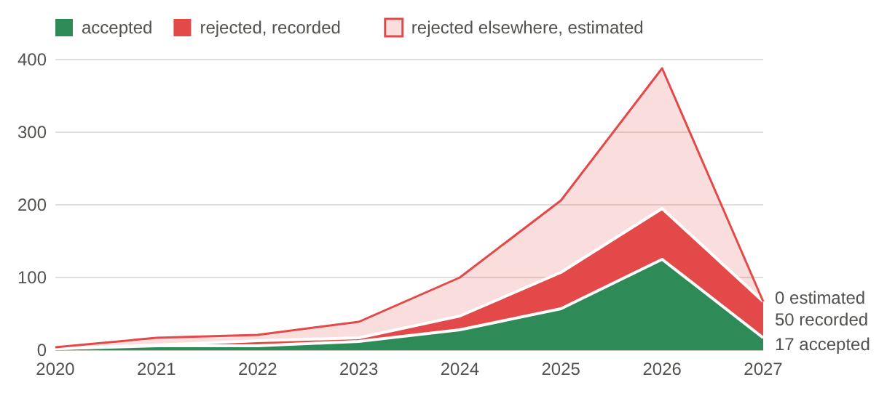
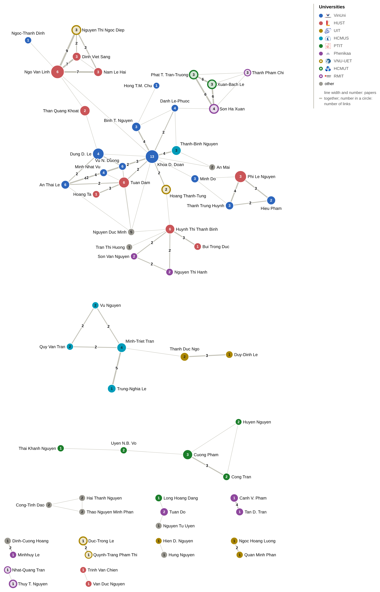

# Vietnam AIRankings

An open-source, data-driven bilingual (Vietnamese / English) static site that tracks and benchmarks scientific publications from faculty at Vietnamese universities at premier international conferences in artificial intelligence.

Publications are tracked from 2020 onward across ten flagship conferences in four core subfields following the [CSRankings](https://csrankings.org/) model:
- **AI:** AAAI, IJCAI
- **ML:** ICLR, NeurIPS, ICML
- **CV:** CVPR, ICCV (odd years), ECCV (even years)
- **NLP:** ACL, EMNLP

**Live Website:** <https://thanhle.xyz/ranking>

### Sample data: top 10 by CSRankings score (2026-11-25)

Accepted main-track papers per area (unofficial acceptances included) and the CSRankings score; the full table is on the [live site](https://thanhle.xyz/ranking).

| # | Professor | University | AI | ML | CV | NLP | CSRankings score |
|---:|---|---|---:|---:|---:|---:|---:|
| 1 | Đàm Quang Tuấn | HUST | 0 | 12 | 0 | 0 | 5.48 |
| 2 | Ngô Văn Linh | HUST | 6 | 8 | 1 | 15 | 4.96 |
| 3 | Đoàn Đăng Khoa | VinUni | 2 | 18 | 3 | 0 | 4.13 |
| 4 | Nguyễn Phi Lê | HUST | 1 | 9 | 6 | 2 | 3.19 |
| 5 | Phạm Văn Cường | PTIT | 2 | 2 | 9 | 0 | 2.52 |
| 6 | Lê Duy Dũng | VinUni | 2 | 9 | 1 | 1 | 2.47 |
| 7 | Huỳnh Thị Thanh Bình | HUST | 3 | 3 | 0 | 1 | 1.87 |
| 8 | Thân Quang Khoát | HUST | 1 | 7 | 1 | 1 | 1.84 |
| 9 | Quản Thành Thơ | HCMUT | 1 | 1 | 0 | 5 | 1.47 |
| 10 | Phạm Văn Cảnh | Phenikaa | 4 | 1 | 0 | 0 | 1.25 |



*Submissions per year across all listed faculty: accepted papers, recorded rejections (all ICLR submissions, public NeurIPS rejections, and Findings papers), and estimated submissions at non-disclosing venues projected from each professor's ICLR record using Laplace smoothing.*



*Domestic cooperation: each circle is a professor on the list, coloured by university. Lines join co-authors, and the number on a line counts their shared papers.*

---

## Key Features & Methodology

- **Scope & Criteria:** Tracks Vietnamese lecturers, assistant professors, associate professors, and full professors whose primary appointment is at a university in Vietnam. Only official full-length Main Track papers (Long Papers) are counted toward primary rankings.
- **CSRankings Scoring:** Each paper receives 1.0 point divided equally among all authors (`1 / N`). An institution's score is the geometric mean of `(Area Score + 1)` across all four subfields.
- **Authorship Perspectives:** Provides dedicated filters for **first-author** and **majority-institution (>50%)** publications, highlighting direct lab mentoring and internal student guidance versus broad external collaborations.
- **Submission Modeling:** Accounts for differing review disclosure policies across venues. Confirmed acceptances at confidential venues are extrapolated based on the professor's demonstrated ICLR submission and acceptance rates.
- **Interactive Visualizations:** Includes the domestic and international cooperation graphs, annual publication trends, and venue distributions.

---

## How to Maintain

The site is designed to be maintained with the assistance of an AI coding agent (such as Claude Code or Gemini via Antigravity) through natural language requests. All operational rules and maintenance workflows are documented in [AGENT.md](AGENT.md).

Common maintenance requests:
- *"Track `<OpenReview profile URL>`, they are a lecturer at `<university>`."*
- *"Add these unofficial acceptances from `<announcement link or text>`."*
- *"Update profile photo for `<name>` from `<link>`."*
- *"Fix attribution for `<link>` (reassign university or resolve namesake). "*
- *"Refresh the data after new conference proceedings are released."*
- *"Publish updates."*

You can verify all updates locally before deploying (`make run`, accessible at <http://localhost:1313>).

---

## Requirements & Setup

### Prerequisites
- **Python:** 3.10+
- **Hugo:** Extended version (0.156+)
- **System Tools:** `poppler` (`pdftotext`), `imagemagick`
- **Python Libraries:**
  ```bash
  pip install openreview-py networkx opencv-python-headless
  ```

### Credentials
Set your OpenReview credentials in your local environment so that the backend can query submission records:
```bash
export OPENREVIEW_USERNAME="your-username"
export OPENREVIEW_PASSWORD="your-password"
```

### Common Commands

```bash
make run       # Start local development server at http://localhost:1313
make data      # Rebuild JSON data and content stubs from raw caches
make build     # Build production site with Hugo (must have zero warnings)
make test      # Run all 30 backend unit tests
make publish   # Build the production site and deploy to GitHub Pages
```
